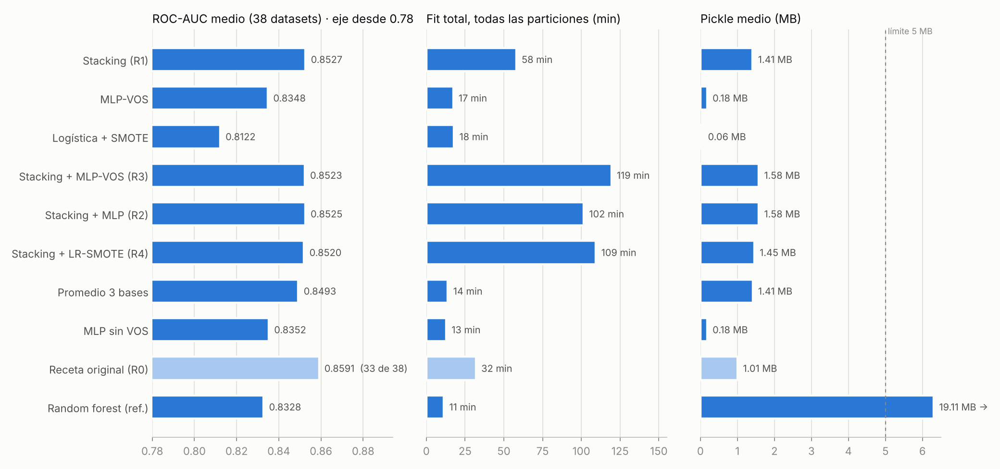
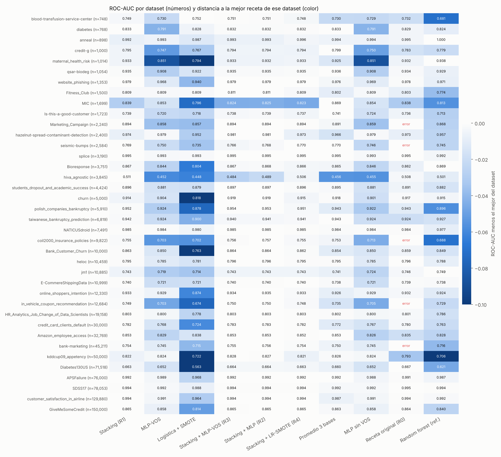

# testbench

Recetas de clasificación tabular (solo NumPy, pandas y scikit-learn; Python 3.11, scikit-learn ≥ 1.4)
para evaluarse con una réplica manual del protocolo de TabArena-v0.1 (38 tareas de clasificación).
Las tres principales (stacking, MLP-VOS y logística + SMOTE) ya están evaluadas; kNN + SMOTE y ExtraTrees
balanceado están implementadas y probadas con datos sintéticos, pero aún no corren en el benchmark.

**Estado: las tres recetas principales y sus controles, evaluados en los 38 datasets de clasificación de TabArena-v0.1 con sus particiones oficiales
(594 particiones por receta).** Resultados completos: [`results/summary.md`](results/summary.md). Plan completo, decisiones y bitácora: [`PLAN.md`](PLAN.md).

## Resultados (TabArena-v0.1, clasificación)

38 datasets (30 binarios, 8 multiclase), particiones oficiales de OpenML (10×3 en los de < 2,500 filas, 3×3 en el
resto) = 594 ajustes por receta. ROC-AUC por dataset = promedio sobre sus particiones. Tiempos en un contenedor de
2 CPU, una variante a la vez. Tablas por dataset y por clase, Elo y errores en [`results/summary.md`](results/summary.md);
datos crudos por partición en `results/raw/`.



| Receta | ROC-AUC medio | Fit total | Fit máx. | Pickle medio | Pickle máx. | Errores |
|---|---|---|---|---|---|---|
| **Stacking (R1)** | **0.8527** | 58 min | 67.1 s | 1.41 MB | 4.21 MB | 0 |
| MLP-VOS | 0.8348 | 17 min | 33.4 s | 0.18 MB | 0.88 MB | 0 |
| Logística + SMOTE | 0.8122 | 18 min | 56.6 s | 0.06 MB | 0.72 MB | 0 |
| Stacking + MLP-VOS (R3) | 0.8523 | 119 min | 91.4 s | 1.58 MB | 4.35 MB | 0 |
| Stacking + MLP sin VOS (R2) | 0.8525 | 102 min | 87.4 s | 1.58 MB | 4.35 MB | 0 |
| Stacking + LR-SMOTE (R4, demostrativa) | 0.8520 | 109 min | 145.9 s | 1.45 MB | 4.50 MB | 0 |
| Promedio simple de las 3 bases | 0.8493 | 14 min | 13.9 s | 1.41 MB | 4.21 MB | 0 |
| MLP sin VOS | 0.8352 | 13 min | 29.7 s | 0.18 MB | 0.88 MB | 0 |
| Receta original (R0, referencia) | 0.8591 en 33 datasets* | 32 min (33 datasets) | 64.0 s | 1.01 MB | 3.30 MB | 66 particiones (5 datasets) |
| Random forest por defecto (referencia) | 0.8328 | 11 min | 26.1 s | 19.11 MB | 106.33 MB | 0 |

"Fit total" = suma del tiempo de fit de las 594 particiones (lo que tarda la receta en todo el benchmark, sin
predicción ni carga de datos); "Fit máx." = la partición más lenta, que es la que importa para el límite de 5 min.

\* La receta original falla con `window shape cannot be larger than input array shape` en Marketing_Campaign,
seismic-bumps, coil2000_insurance_policies, in_vehicle_coupon_recommendation y bank-marketing; su promedio no es
comparable. En los 33 datasets donde todas terminan, el stacking da 0.8630 y la original 0.8591.

**Error conocido del cargador (pendiente de corregir).** En esos 5 datasets y en HR_Analytics hay columnas de texto
que OpenML marca como `string`; `fetch_data.py` las anota como `numeric` en el esquema y `run.py` las convierte a
número, así que se vuelven NaN (seismic-bumps: `ghazard`; bank-marketing: `poutcome`; coil2000: `avgAge` y otra;
in_vehicle_coupon: `coupon`; Marketing_Campaign: `Dt_Customer`; HR_Analytics: los valores ">20" y "<1" de
`experience`). Los archivos descargados están bien; el error es solo de la etiqueta. Consecuencias:
- Todas las recetas se evaluaron en esos 6 datasets sin esas 1–2 variables. La comparación entre recetas es justa
  (a todas les faltó lo mismo), pero los ROC-AUC absolutos ahí probablemente están algo bajos.
- La receta original truena porque le queda una columna 100 % vacía en el entrenamiento y no la descarta; con datos
  bien cargados probablemente no fallaría. El stacking sí descarta esas columnas.
- Arreglo previsto: tratar como categórica toda columna con texto no numérico y volver a correr esos 6 datasets.

**Comparaciones pareadas** (diferencia media de ROC-AUC por dataset, IC 95 % por bootstrap):

| Comparación | Diferencia [IC 95 %] | Gana–pierde | Lectura |
|---|---|---|---|
| Stacking vs. receta original (33 datasets) | +0.0039 [+0.0017, +0.0066] | 27–6 | Mejor, y sin errores |
| Stacking vs. random forest por defecto | +0.0199 [+0.0131, +0.0283] | 32–6 | Mejor |
| Stacking (meta-modelo) vs. promedio simple | +0.0034 [+0.0003, +0.0073] | 26–12 | El meta-modelo aporta, poco |
| MLP con VOS vs. MLP sin VOS | −0.0004 [−0.0012, +0.0003] | 17–21 | Sin efecto |
| Stacking + MLP-VOS vs. stacking + MLP sin VOS | −0.0002 [−0.0006, −0.0000] | 16–22 | VOS no ayuda (pérdida mínima) |
| Stacking + MLP sin VOS vs. stacking | −0.0001 [−0.0018, +0.0011] | 24–14 | Una 4.ª base no cambia el promedio |
| Stacking + LR-SMOTE vs. stacking | −0.0007 [−0.0017, +0.0000] | 13–25 | La rama con SMOTE no ayuda |

**Lo que dicen los resultados**
- La receta de stacking es la mejor de las tres y supera a la original sin fallar en ningún dataset. La mejora es
  pequeña en promedio (+0.004) pero consistente (27 de 33 datasets).
- **VOS no mejora la clasificación**, ni sola ni dentro del stacking: resultado negativo, coherente con que el paper
  es de detección fuera de distribución. Agregar la MLP como 4.ª base (con o sin VOS) duplica el tiempo y no mejora el
  ROC-AUC medio, aunque gana el rango medio y el Elo (intervalos traslapados con R1).
- Logística + SMOTE es la más débil (−0.02 frente al random forest); como rama del stacking no aporta.
- Riesgos de tiempo (guía del curso: ~60 s por dataset en laptop): el stacking llega a 67 s en hiva_agnostic
  (1,617 columnas categóricas); R3 a 91 s y R4 a 146 s. El random forest de referencia pasa de 5 MB.
- hiva_agnostic: ninguna receta aprende (ROC-AUC ≈ 0.45–0.51), tampoco modelos simples con validación cruzada.
  Sin verificar si es el dataset o la descarga.

**Cómo leer la gráfica por dataset:** cada cuadro es el ROC-AUC de una receta en un dataset. Entre más fuerte el
azul, más cerca está de la mejor receta de ese dataset; claro, lejos. La mejor de cada dataset (o las empatadas a 3
decimales) va en negritas con recuadro, y bajo cada receta se indica en cuántos datasets fue la mejor o empató. Gris
= la receta falló. Se ve, por ejemplo, que Logística + SMOTE es la columna más clara (más lejos de la mejor) y que
los stackings son los más azules.



## Cómo reproducir

```bash
python bench/fetch_data.py            # datos y particiones oficiales (OpenML)
python bench/validate_data.py         # 38/38 válidos
bash bench/run_all.sh                 # todas las variantes, reanudable; luego genera results/
```

Al correr KNN, KNN-SMOTE, ET y ET-BAL, `aggregate.py` genera dos gráficas aparte
(`results/nuevas_recetas.png` y `results/efecto_smote_y_pesos.png`) sin tocar las de arriba.
Instructivo completo, paso a paso (correr solo algunas variantes, reanudar, agregar y leer resultados):
[`BENCHMARK.md`](BENCHMARK.md).

## Recetas

Cinco archivos autocontenidos en [`recipe/`](recipe/), cada uno listo para entregar tal cual
(`build_model()` → `fit` → `predict_proba`, columnas en el orden de `classes_`):

| Archivo | Qué es |
|---|---|
| [`recipe/stacking.py`](recipe/stacking.py) | Stacking: regresión logística L2 + HistGradientBoosting + ExtraTrees, cada una con su preprocesamiento; meta-modelo logístico L2 entrenado solo con predicciones OOF |
| [`recipe/mlp_vos.py`](recipe/mlp_vos.py) | MLP en NumPy con VOS (Virtual Outlier Synthesis) |
| [`recipe/logistic_smote.py`](recipe/logistic_smote.py) | Regresión logística + SMOTE (implementado en NumPy) con corrección de prior |
| [`recipe/knn_smote.py`](recipe/knn_smote.py) | kNN con SMOTE (o sin él, como control); preprocesamiento propio para distancias |
| [`recipe/extratrees.py`](recipe/extratrees.py) | ExtraTrees con `class_weight="balanced"` (o sin pesos, como control) |

Las variantes de comparación se arman en [`bench/variants.py`](bench/variants.py) sin duplicar código:

| Variante | Cómo se construye | Para qué |
|---|---|---|
| `R1` | `stacking.build_model()` | Receta de stacking |
| `R1-AVG` | `stacking.build_model("R1-AVG")` | Mismas 3 bases, promedio simple |
| `R2` | stacking + `mlp_vos.MLPBase(use_vos=False)` como 4.ª base | Control de R3 |
| `R3` | stacking + `mlp_vos.MLPBase(use_vos=True)` como 4.ª base | VOS dentro del stack |
| `MLP` | `mlp_vos.build_model(use_vos=False)` | Control de MLP-VOS (misma red, sin VOS) |
| `MLP-VOS` | `mlp_vos.build_model()` | MLP con VOS sola |
| `LR-SMOTE` | `logistic_smote.build_model()` | Logística + SMOTE |
| `R4` | stacking + `logistic_smote.LRSmoteBase()` como 4.ª base | **Demostrativa:** cómo se encapsula una rama con SMOTE dentro del stacking |
| `KNN-SMOTE` | `knn_smote.build_model(use_smote=True)` | kNN + SMOTE (**aún sin correr en el benchmark**) |
| `KNN` | `knn_smote.build_model(use_smote=False)` | Control de KNN-SMOTE (mismo kNN, sin SMOTE) |
| `ET-BAL` | `extratrees.build_model(class_weight="balanced")` | ExtraTrees balanceado (**aún sin correr en el benchmark**) |
| `ET` | `extratrees.build_model(class_weight=None)` | Control de ET-BAL (mismo bosque, sin pesos) |
| `B-LIN`, `B-HGB`, `B-SMALL` | `stacking.build_model("B-...")` | Cada base sola |

### Principio: cada modelo tiene su propio preprocesamiento

Ningún modelo comparte codificación, imputación ni escalado con otro. Cada uno recibe la tabla **cruda** y
ajusta su propio preprocesamiento dentro de su `fit` (y por tanto dentro de cada fold del stacking), con los
umbrales que le convienen. Así lo que necesita uno (por ejemplo, escalar para la logística o la red) no le
estorba a otro (los árboles no lo necesitan), y cada modelo ataca los datos donde es mejor. Lo único común
es código de utilería (alinear probabilidades, detectar qué columnas son numéricas) y las clases de
herramientas (`CategoryCapper`, `CountEncoder`, `FreqOrdinal`), de las que cada modelo crea sus propias
instancias. `tests/check_independence.py` comprueba que en el stacking con MLP ninguna base comparte un
solo objeto de preprocesamiento con otra y que todas reciben columnas crudas.

| | Numéricas | Faltantes | Categóricas pocas | Categóricas muchas | Escalado |
|---|---|---|---|---|---|
| Logística (stacking) | mediana | indicador | one-hot (≤ 30) | target encoding CV + frecuencia (> 30) | robusto + recorte |
| HistGradientBoosting | tal cual | nativos | nativas (254 más frecuentes) | nativas + target encoding CV + frecuencia (> 254) | ninguno |
| ExtraTrees | mediana | indicador | código ordinal por frecuencia | ordinal + frecuencia (> 30), sin target encoding | ninguno |
| MLP (con/sin VOS) | mediana | indicador aparte | one-hot (≤ 20) | target encoding CV + frecuencia (> 20) | cuantiles → normal (robusto si hay demasiadas columnas) |
| Logística + SMOTE-NC | mediana | indicador (categórico para SMOTE) | código → one-hot después de SMOTE (≤ 30) | target encoding CV + frecuencia (> 30) | estandarizado + recorte (SMOTE usa distancias) |

### Receta de stacking (R1)
- **Bases:** las tres primeras filas de la tabla. HGB con early stopping interno, iteraciones acotadas por el
  presupuesto de pickle y, con > 256 columnas numéricas, las 256 de mayor F de ANOVA (calculada con sus filas).
  ExtraTrees de tamaño acotado (64 hojas por árbol, número de árboles según presupuesto).
- **Meta-modelo:** regresión logística L2 sobre los logits OOF de cada base (5 folds si n < 5,000 y no es ancho;
  3 si no; con más de 30,000 filas, OOF sobre una submuestra estratificada de 30,000). En cada fold cada base
  ajusta desde cero su preprocesamiento y su modelo. Luego cada base se reentrena con todas las filas.
- **Límites:** presupuesto de 4.4 MB de pickle repartido entre bases (el HGB usa lo que sobra, medido).

### MLP + VOS
MLP de dos capas ocultas (ReLU, Adam, L2) escrita en NumPy, con VOS fiel al Algoritmo 1 de Du et al. (ICLR 2022):
cola por clase en la penúltima capa, gaussianas por clase con covarianza compartida, outlier virtual = la muestra
de menor verosimilitud entre 10,000 (muestreada de forma exacta vía el máximo de χ²), energía libre con pesos
aprendidos y pérdida logística ID vs virtual con β = 0.1. Entrenamiento en dos pasadas idénticas con y sin VOS:
la primera (sin VOS, con validación) fija el número de épocas; la segunda reentrena con todas las filas y activa VOS
desde el 40 % de las épocas, como el paper. Desviación documentada: la cola de cada clase mide min(1000, n_clase).
Los gradientes (incluido el término VOS) se verifican contra diferencias finitas en `tests/gradcheck_vos.py`.
Como 4.ª base del stacking usa su propio preprocesamiento (no el de la logística).

### Cómo se juntan: pipeline general del stacking

```
tabla cruda X
   ├─► pipeline propio de la logística ─► logística ─┐
   ├─► pipeline propio del HGB ────────► HGB ───────┤  probabilidades
   ├─► pipeline propio de ExtraTrees ──► ET ────────┤  fuera de muestra
   └─► pipeline propio de la 4.ª rama ─► MLP-VOS / logística+SMOTE ─┘
                                                     ▼
          pipeline general: probabilidades → logits → meta-modelo L2 → predicción final
```

El pipeline general no vuelve a preprocesar columnas: solo recibe las probabilidades de cada rama. En R4 la rama
de logística + SMOTE-NC lleva su preprocesamiento y su SMOTE dentro de su propio `fit`, así que en cada fold
solo genera filas sintéticas con las filas de entrenamiento de ese fold, nunca con las que ve el meta-modelo;
y como corrige sus probabilidades al prior original, le entrega al meta-modelo probabilidades en la misma escala
que las otras ramas. Es demostrativa: probablemente aporte poca diversidad, porque es una segunda logística.

### Logística + SMOTE-NC
SMOTE-NC (Chawla et al., 2002, §6.1) implementado en NumPy, solo con filas de entrenamiento: las numéricas se
interpolan entre un punto y un vecino de su clase; las categóricas (y los indicadores de faltante) toman la
categoría más frecuente entre sus k = 5 vecinos, así nunca salen categorías "a medias" como pasaría
interpolando un one-hot. Cada clase se lleva al tamaño de la mayoritaria (tope de 300,000 filas). Como SMOTE
cambia las proporciones de clase, los logits se corrigen al prior original (+ log π/π'), necesario para log-loss;
en AUC binario no cambia el orden.

### kNN + SMOTE
kNN es el modelo donde SMOTE tiene más sentido: interpola en el mismo espacio de distancias donde kNN decide.
Preprocesamiento propio para distancias: numéricas con mediana, estandarizado y recorte a ±5; indicadores de
faltante; categóricas de ≤ 30 valores en one-hot escalado por 1/√2 (una categoría distinta pesa como una
desviación estándar); alta cardinalidad con target encoding (validación cruzada) + frecuencia. Si quedan más de
32 dimensiones, PCA a 32. SMOTE se aplica en ese espacio, solo con filas de entrenamiento. Reglas fijas por
tamaño: k = √n / 2 (entre 5 y 50), pesos por distancia y, como kNN guarda sus ejemplos en el pickle, a lo más
30,000 ejemplos o los que quepan en 3 MB (muestra estratificada). Las probabilidades se corrigen al prior
original (π/π′) y se suavizan con un vecino virtual que vota con el prior, (k·p + π)/(k + 1): sin eso kNN da
probabilidades exactamente 0, que disparan el log-loss en multiclase (en binario no cambia la AUC).

### ExtraTrees balanceado
El mismo bosque con y sin `class_weight="balanced"`: los errores en clases raras pesan más al elegir los
cortes, sin inventar filas (a diferencia de SMOTE). Preprocesamiento propio y mínimo, porque los árboles no
necesitan escalar: mediana + indicador de faltante en numéricas; categóricas como código ordinal por frecuencia
(faltante = −1) y log de frecuencia para las de más de 30 valores. Tamaño acotado: árboles de 256 hojas,
tantos como quepan en ~3.5 MB (entre 30 y 300), con a lo más 50,000 filas por árbol.

## Datos

Los datos no se guardan en el repo (licencias de origen distintas). Se descargan de OpenML con:

```bash
python bench/fetch_data.py            # los 38 datasets de clasificación de TabArena-v0.1
python bench/fetch_data.py credit-g   # o solo algunos
```

Requiere Python 3.11, numpy y pandas (usa la API REST de OpenML, sin paquetes extra). Descarga 4 datasets
en paralelo (`--jobs=N` para cambiarlo) y, si se corta, al volver a correrlo retoma donde se quedó.
Enlaces directos de cada dataset y de sus particiones, para bajarlos a mano: [`bench/DESCARGAS.md`](bench/DESCARGAS.md). Escribe en
`data/` los datos, el esquema y las particiones oficiales de cada task, y verifica filas, columnas,
clases y tamaños de cada partición contra `bench/TabArena-v0.1_tasks_metadata.csv` (copia sin
modificar de [autogluon/tabarena](https://github.com/autogluon/tabarena), Apache-2.0).
El resultado queda en `data/manifest.json` (con md5 de cada archivo); ese manifest sí se sube al
repo como `bench/data_manifest.json` para que cualquiera compruebe que bajó lo mismo.

## Pruebas hechas (solo datos sintéticos; no son evidencia de desempeño)

```bash
python tests/check_recipes.py edge     # casos raros, todas las variantes
python tests/check_recipes.py smoke    # 80/20 sintético
python tests/check_recipes.py stress   # peor caso: tiempo y tamaño de pickle
python tests/check_recipes.py repro    # dos ajustes iguales -> mismas probabilidades
python tests/check_independence.py     # ninguna base comparte preprocesamiento con otra
python tests/gradcheck_vos.py          # gradientes de la MLP y de VOS vs diferencias finitas
```

- **Casos raros:** 44/44 correctos (11 variantes × 4 casos: 8 clases con la menor de 2 ejemplos, binario con
  3 positivos, etiquetas de texto, clase de ~0.8 %; en test: categorías nunca vistas, filas todo NaN, columna
  vacía y constante). Probado en Python 3.13 + scikit-learn 1.9.1 y en Python 3.11 + scikit-learn 1.4.2 y 1.6.1.
- **Reproducibilidad:** 11/11 variantes dan las mismas probabilidades en dos ajustes, en las tres versiones.
- **Independencia del preprocesamiento:** 0 objetos compartidos entre las 4 bases del stacking, con MLP (R3) y con logística + SMOTE (R4).
- **Gradientes:** error relativo máximo 1.4e-7.
- **Peor caso** (sandbox de 2 CPU)

| Caso sintético | R1 fit | R3 fit | MLP-VOS fit | LR-SMOTE fit | Pickle máx. |
|---|---|---|---|---|---|
| 100k × 39, 5 clases, alta cardinalidad | 14.5 s | 24.0 s | 3.7 s | 8.4 s | 3.18 MB |
| 3,750 × 1,776, binario | 15.1 s | 19.3 s | 1.5 s | 0.5 s | 2.64 MB |
| 3,850 × 1,617, 3 clases (una de 1 %) | 8.5 s | 13.3 s | 1.4 s | 0.8 s | 2.28 MB |
| 150k × 10, binario desbalanceado | 2.6 s | 10.9 s | 3.6 s | 0.3 s | 1.07 MB |

R4 (demostrativa): 31.6 s / 15.6 s / 10.7 s / 3.3 s en los mismos cuatro casos; pickle máximo 3.07 MB.

kNN y ExtraTrees en los mismos cuatro casos (fit; casos raros 16/16 y reproducibilidad 4/4):

| Caso sintético | KNN-SMOTE | KNN | ET-BAL | ET | Pickle máx. |
|---|---|---|---|---|---|
| 100k × 39, 5 clases, alta cardinalidad | 1.0 s | 0.7 s | 1.5 s | 1.4 s | 4.12 MB |
| 3,750 × 1,776, binario | 0.5 s | 0.5 s | 0.7 s | 0.8 s | 3.45 MB |
| 3,850 × 1,617, 3 clases (una de 1 %) | 0.4 s | 0.4 s | 0.5 s | 0.6 s | 2.85 MB |
| 150k × 10, binario desbalanceado | 0.3 s | 0.1 s | 1.2 s | 1.0 s | 4.34 MB |

En kNN el costo está en `predict_proba` (hasta 2.7 s para 30k filas de test), no en el fit.

## Medido / pendiente / hipótesis

| | Contenido |
|---|---|
| Medido | Las 10 variantes en los 38 datasets × particiones oficiales (sección Resultados); pruebas sintéticas de bordes, reproducibilidad, independencia y gradientes |
| Pendiente | Correr KNN, KNN-SMOTE, ET y ET-BAL en el benchmark ([`BENCHMARK.md`](BENCHMARK.md)); comparar contra el leaderboard oficial de TabArena con su framework (nuestro Elo es una réplica propia y solo entre estas variantes); verificar el dataset hiva_agnostic contra la fuente; medir en la máquina del curso |
| Hipótesis confirmada | VOS no mejora la clasificación dentro de la distribución (diferencias ≤ 0.0004, sin efecto o pérdida mínima) |
| Sin verificar | Que el reto del curso use estos mismos 38 datasets (coinciden en número, tipo y columnas) y que su dataset_37 sea hiva_agnostic |

## Otros

- `legacy/submission_original.py`: receta original (HGB 70 % + LR 30 %).
- `legacy/submission_iter1.py`: primera iteración (mezcla aprendida fuera de muestra).
- `legacy/banco_desarrollo/`: banco PMLB + sintéticos de la primera iteración. **Sesgado; no es evidencia** (ver PLAN.md §2).
