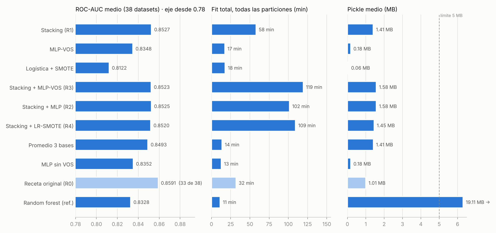
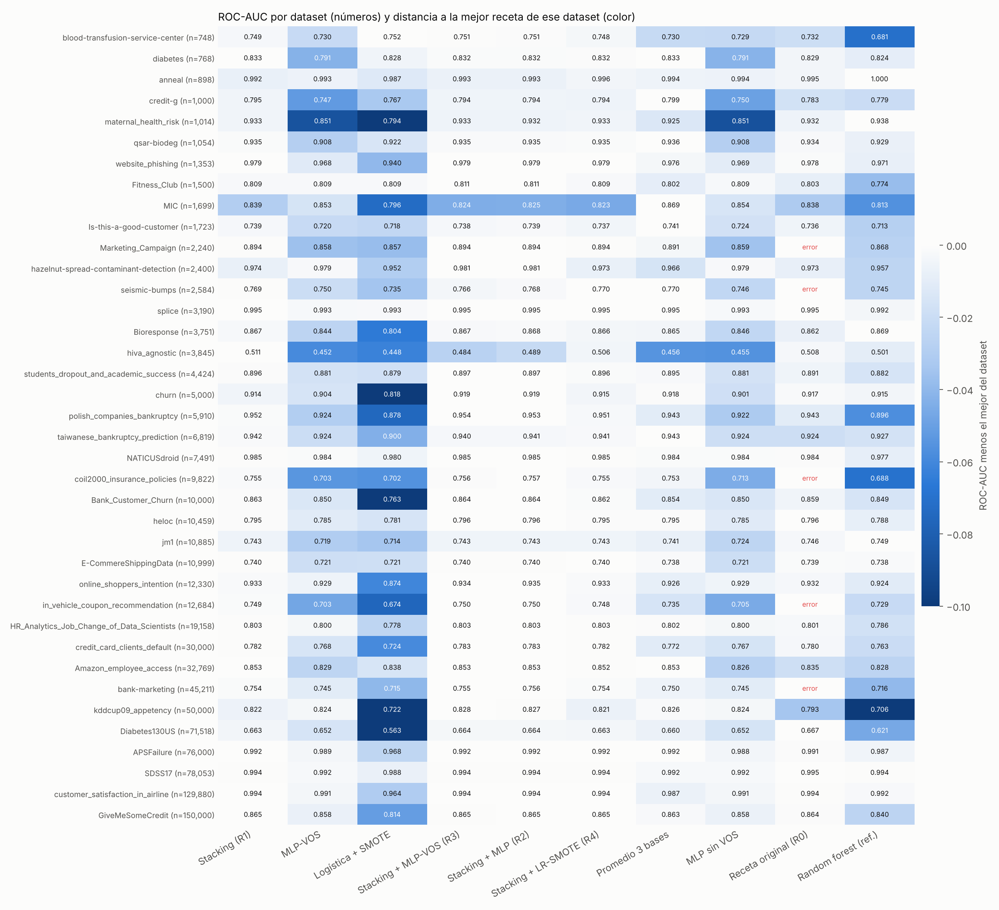

# TabArena-v0.1 (clasificación): resultados

Datasets: 38 (30 binarios, 8 multiclase). Métricas por dataset = promedio sobre sus particiones oficiales evaluadas (hasta 30). ROC-AUC binario sobre la clase `classes_[1]`; multiclase = promedio uno-contra-todos de las clases presentes en test. Tiempos medidos en un contenedor de 2 CPU, una variante a la vez.

## Promedio por receta

"Datasets" = datasets con resultado; si una receta falla en alguno, sus promedios son sobre los que sí terminó (ver Errores), así que no son directamente comparables con los de 38.

Tiempos: el protocolo de TabArena entrena cada dataset varias veces (una por partición), así que hay tres lecturas. "Fit típico" = un entrenamiento en un dataset típico (mediana entre datasets del fit promedio de cada uno): lo que tarda un uso normal. "Fit máx." = el entrenamiento más lento de todo el benchmark: el peor caso, el que se compara con el límite por dataset. "Fit total" = suma de todas las particiones que terminaron: lo que tarda correr el benchmark completo (sin predicción ni carga de datos).

La columna "AUC 33 comunes" promedia solo los datasets donde todas las recetas terminaron, para comparar en igualdad de condiciones.

| Receta | Datasets | ROC-AUC medio | AUC 33 comunes | AUC binarios | AUC multiclase | Log-loss multiclase | Rango medio (AUC) | Gana | Fit típico | Fit máx. | Fit total | Pickle medio | Pickle máx. | Errores |
|---|---|---|---|---|---|---|---|---|---|---|---|---|---|---|
| Stacking (R1) | 38 | **0.8527** | 0.8630 | 0.8420 | 0.8924 | 0.2731 | 3.47 | 3 | 3.7 s | 67.1 s | 58.0 min | 1.41 MB | 4.21 MB | 0 |
| MLP-VOS | 38 | **0.8348** | 0.8474 | 0.8247 | 0.8729 | 0.3287 | 7.53 | 0 | 1.3 s | 33.4 s | 17.3 min | 0.18 MB | 0.88 MB | 0 |
| Logística + SMOTE | 38 | **0.8122** | 0.8236 | 0.8013 | 0.8531 | 0.4318 | 8.92 | 1 | 0.2 s | 56.6 s | 17.8 min | 0.06 MB | 0.72 MB | 0 |
| Stacking + MLP-VOS (R3) | 38 | **0.8523** | 0.8626 | 0.8430 | 0.8873 | 0.2793 | 3.03 | 7 | 9.2 s | 91.4 s | 119.4 min | 1.58 MB | 4.35 MB | 0 |
| Stacking + MLP (R2) | 38 | **0.8525** | 0.8627 | 0.8431 | 0.8880 | 0.2795 | 2.84 | 9 | 7.6 s | 87.4 s | 101.5 min | 1.58 MB | 4.35 MB | 0 |
| Stacking + LR-SMOTE (R4) | 38 | **0.8520** | 0.8622 | 0.8418 | 0.8901 | 0.2772 | 3.76 | 4 | 4.7 s | 145.9 s | 109.4 min | 1.45 MB | 4.50 MB | 0 |
| Promedio 3 bases | 38 | **0.8493** | 0.8598 | 0.8390 | 0.8876 | 0.3202 | 4.95 | 8 | 0.8 s | 13.9 s | 13.9 min | 1.41 MB | 4.21 MB | 0 |
| MLP sin VOS | 38 | **0.8352** | 0.8476 | 0.8251 | 0.8735 | 0.3286 | 7.50 | 0 | 1.0 s | 29.7 s | 12.8 min | 0.18 MB | 0.88 MB | 0 |
| Receta original (R0) | 33 | **0.8591** | 0.8591 | 0.8487 | 0.8915 | 0.2927 | 5.12 | 2 | 1.6 s | 64.0 s | 32.0 min | 1.01 MB | 3.30 MB | 66 |
| Random forest (ref.) | 38 | **0.8328** | 0.8455 | 0.8186 | 0.8862 | 0.4412 | 7.24 | 4 | 0.4 s | 26.1 s | 11.3 min | 19.11 MB | 106.33 MB | 0 |

## Elo (Bradley-Terry por dataset, RF = 1000, IC 95 % por bootstrap)

Dos versiones: con ROC-AUC en los 38 datasets (como el curso) y "como TabArena" (ROC-AUC en binarios, log-loss en multiclase). Réplica propia del método, no el código oficial. Un dataset con error cuenta como derrota.

| Receta | Elo (ROC-AUC) | Elo (como TabArena) |
|---|---|---|
| Stacking + MLP (R2) | 1434 [1298, 1580] | 1537 [1406, 1695] |
| Stacking + MLP-VOS (R3) | 1413 [1279, 1571] | 1514 [1397, 1670] |
| Stacking (R1) | 1365 [1237, 1502] | 1475 [1365, 1612] |
| Stacking + LR-SMOTE (R4) | 1336 [1238, 1467] | 1429 [1339, 1544] |
| Promedio 3 bases | 1221 [1103, 1370] | 1259 [1158, 1392] |
| Receta original (R0) | 1145 [1054, 1250] | 1213 [1113, 1326] |
| Random forest (ref.) | 1000 [1000, 1000] | 1000 [1000, 1000] |
| MLP sin VOS | 972 [846, 1070] | 1053 [949, 1153] |
| MLP-VOS | 969 [842, 1087] | 1061 [953, 1173] |
| Logística + SMOTE | 793 [617, 947] | 886 [736, 1020] |

## Comparaciones pareadas (ROC-AUC, diferencia media por dataset, IC 95 % bootstrap)

| A vs. B | Datasets | A − B [IC 95 %] | Gana–pierde | ¿IC excluye 0? |
|---|---|---|---|---|
| Stacking (R1) vs. Receta original (R0) | 33 | +0.0039 [+0.0017, +0.0066] | 27–6 | sí |
| Stacking (R1) vs. Random forest (ref.) | 38 | +0.0199 [+0.0131, +0.0283] | 32–6 | sí |
| Stacking (R1) vs. Promedio 3 bases | 38 | +0.0034 [+0.0003, +0.0073] | 26–12 | sí |
| Stacking + MLP (R2) vs. Stacking (R1) | 38 | -0.0001 [-0.0018, +0.0011] | 24–14 | no |
| Stacking + MLP-VOS (R3) vs. Stacking (R1) | 38 | -0.0004 [-0.0023, +0.0010] | 23–15 | no |
| Stacking + MLP-VOS (R3) vs. Stacking + MLP (R2) | 38 | -0.0002 [-0.0006, -0.0000] | 16–22 | sí |
| MLP-VOS vs. MLP sin VOS | 38 | -0.0004 [-0.0012, +0.0003] | 17–21 | no |
| Stacking + LR-SMOTE (R4) vs. Stacking (R1) | 38 | -0.0007 [-0.0017, +0.0000] | 13–25 | no |
| MLP-VOS vs. Random forest (ref.) | 38 | +0.0020 [-0.0079, +0.0129] | 20–18 | no |
| Logística + SMOTE vs. Random forest (ref.) | 38 | -0.0206 [-0.0329, -0.0090] | 9–29 | sí |

## Multiclase: ROC-AUC por clase (uno contra todos, promedio sobre particiones)

Clases en el orden de `classes_` (orden de las etiquetas).

| Dataset | Stacking (R1) | Stacking + MLP-VOS (R3) | MLP-VOS | Logística + SMOTE | Receta original (R0) | Random forest (ref.) |
|---|---|---|---|---|---|---|
| anneal | 0.966 / 1.000 / 0.997 / 1.000 / 0.997 | 0.972 / 0.999 / 0.996 / 1.000 / 0.996 | 0.986 / 0.997 / 0.993 / 1.000 / 0.991 | 0.993 / 0.992 / 0.980 / 1.000 / 0.973 | 0.985 / 1.000 / 0.998 / 1.000 / 0.995 | 0.999 / 1.000 / 0.999 / 1.000 / 1.000 |
| maternal_health_risk | 0.973 / 0.931 / 0.896 | 0.972 / 0.930 / 0.895 | 0.945 / 0.849 / 0.761 | 0.915 / 0.813 / 0.654 | 0.974 / 0.929 / 0.893 | 0.975 / 0.935 / 0.905 |
| website_phishing | 0.976 / 0.975 / 0.986 | 0.976 / 0.975 / 0.985 | 0.968 / 0.969 / 0.967 | 0.958 / 0.963 / 0.897 | 0.973 / 0.972 / 0.988 | 0.966 / 0.965 / 0.983 |
| MIC | 0.934 / 0.757 / 0.951 / 0.827 / 0.875 / 0.800 / 0.791 / 0.781 | 0.930 / 0.714 / 0.947 / 0.818 / 0.862 / 0.779 / 0.781 / 0.764 | 0.918 / 0.770 / 0.952 / 0.822 / 0.852 / 0.855 / 0.845 / 0.812 | 0.884 / 0.623 / 0.941 / 0.814 / 0.822 / 0.786 / 0.762 / 0.734 | 0.925 / 0.742 / 0.949 / 0.832 / 0.886 / 0.826 / 0.798 / 0.743 | 0.913 / 0.735 / 0.942 / 0.799 / 0.831 / 0.791 / 0.753 / 0.736 |
| splice | 0.996 / 0.994 / 0.995 | 0.996 / 0.995 / 0.995 | 0.994 / 0.992 / 0.992 | 0.994 / 0.992 / 0.993 | 0.996 / 0.994 / 0.995 | 0.993 / 0.991 / 0.991 |
| hiva_agnostic | 0.541 / 0.493 / 0.498 | 0.518 / 0.462 / 0.471 | 0.461 / 0.449 / 0.446 | 0.436 / 0.456 / 0.453 | 0.524 / 0.499 / 0.500 | 0.501 / 0.507 / 0.494 |
| students_dropout_and_academic_success | 0.924 / 0.836 / 0.928 | 0.924 / 0.838 / 0.929 | 0.913 / 0.813 / 0.916 | 0.918 / 0.802 / 0.918 | 0.921 / 0.827 / 0.927 | 0.915 / 0.808 / 0.922 |
| SDSS17 | 0.993 / 0.990 / 1.000 | 0.993 / 0.990 / 1.000 | 0.990 / 0.989 / 0.998 | 0.983 / 0.983 / 0.996 | 0.994 / 0.991 / 1.000 | 0.993 / 0.989 / 1.000 |

## Por dataset: ROC-AUC · fit medio (s) · pickle medio (MB)

| Dataset | Tipo | Filas | Feat. | Stacking (R1) | MLP-VOS | Logística + SMOTE | Stacking + MLP-VOS (R3) | Stacking + MLP (R2) | Stacking + LR-SMOTE (R4) | Promedio 3 bases | MLP sin VOS | Receta original (R0) | Random forest (ref.) |
|---|---|---|---|---|---|---|---|---|---|---|---|---|---|
| blood-transfusion-service-center | binary | 748 | 4 | 0.7486 · 1.7 · 1.11 | 0.7301 · 0.3 · 0.05 | **0.7515** · 0.0 · 0.00 | 0.7508 · 4.3 · 1.16 | 0.7507 · 3.3 · 1.16 | 0.7481 · 2.3 · 1.11 | 0.7298 · 0.3 · 1.11 | 0.7293 · 0.2 · 0.05 | 0.7320 · 0.4 · 0.50 | 0.6806 · 0.2 · 1.59 |
| diabetes | binary | 768 | 8 | 0.8330 · 1.6 · 1.13 | 0.7906 · 0.2 · 0.06 | 0.8281 · 0.0 · 0.00 | 0.8316 · 3.4 · 1.19 | 0.8317 · 2.8 · 1.19 | 0.8323 · 2.3 · 1.13 | **0.8331** · 0.4 · 1.13 | 0.7911 · 0.1 · 0.06 | 0.8290 · 0.3 · 0.51 | 0.8237 · 0.2 · 1.45 |
| anneal | multiclass | 898 | 38 | 0.9918 · 3.4 · 1.23 | 0.9933 · 1.2 · 0.10 | 0.9875 · 0.2 · 0.02 | 0.9927 · 12.2 · 1.33 | 0.9928 · 8.8 · 1.33 | 0.9956 · 5.8 · 1.25 | 0.9938 · 0.8 · 1.23 | 0.9936 · 0.7 · 0.10 | 0.9955 · 0.7 · 0.76 | **0.9995** · 0.2 · 0.82 |
| credit-g | binary | 1,000 | 20 | 0.7947 · 2.3 · 1.30 | 0.7472 · 0.3 · 0.09 | 0.7670 · 0.1 · 0.01 | 0.7944 · 5.2 · 1.39 | 0.7943 · 4.2 · 1.39 | 0.7940 · 3.7 · 1.31 | **0.7995** · 0.5 · 1.30 | 0.7499 · 0.2 · 0.09 | 0.7828 · 0.4 · 0.69 | 0.7793 · 0.2 · 2.26 |
| maternal_health_risk | multiclass | 1,014 | 6 | 0.9333 · 3.2 · 2.01 | 0.8513 · 0.8 · 0.05 | 0.7939 · 0.0 · 0.00 | 0.9325 · 8.9 · 2.07 | 0.9322 · 6.5 · 2.07 | 0.9330 · 4.5 · 2.01 | 0.9248 · 0.7 · 2.01 | 0.8507 · 0.4 · 0.05 | 0.9323 · 0.7 · 1.52 | **0.9380** · 0.2 · 2.42 |
| qsar-biodeg | binary | 1,054 | 41 | 0.9350 · 2.3 · 1.14 | 0.9081 · 0.4 · 0.14 | 0.9223 · 0.0 · 0.01 | 0.9346 · 5.7 · 1.28 | 0.9346 · 4.6 · 1.28 | 0.9348 · 3.5 · 1.15 | **0.9364** · 0.5 · 1.14 | 0.9080 · 0.3 · 0.14 | 0.9342 · 0.4 · 0.49 | 0.9291 · 0.2 · 1.35 |
| website_phishing | multiclass | 1,353 | 9 | **0.9791** · 3.9 · 2.30 | 0.9680 · 0.7 · 0.05 | 0.9395 · 0.1 · 0.01 | 0.9789 · 8.0 · 2.35 | 0.9789 · 6.1 · 2.35 | 0.9790 · 4.8 · 2.31 | 0.9757 · 0.7 · 2.32 | 0.9692 · 0.4 · 0.05 | 0.9779 · 0.7 · 1.75 | 0.9712 · 0.2 · 2.65 |
| Fitness_Club | binary | 1,500 | 6 | 0.8091 · 2.8 · 1.22 | 0.8090 · 0.2 · 0.06 | 0.8092 · 0.0 · 0.01 | **0.8112** · 4.4 · 1.28 | 0.8110 · 3.3 · 1.28 | 0.8089 · 2.8 · 1.23 | 0.8018 · 0.4 · 1.22 | 0.8087 · 0.2 · 0.06 | 0.8029 · 0.4 · 0.44 | 0.7735 · 0.2 · 3.59 |
| MIC | multiclass | 1,699 | 111 | 0.8394 · 12.2 · 2.23 | 0.8533 · 0.9 · 0.28 | 0.7957 · 1.5 · 0.06 | 0.8244 · 17.4 · 2.37 | 0.8248 · 15.9 · 2.37 | 0.8226 · 20.7 · 2.25 | **0.8686** · 2.3 · 2.24 | 0.8538 · 0.7 · 0.28 | 0.8377 · 2.8 · 2.03 | 0.8126 · 0.3 · 3.68 |
| Is-this-a-good-customer | binary | 1,723 | 13 | 0.7385 · 3.0 · 1.27 | 0.7202 · 0.4 · 0.07 | 0.7181 · 0.0 · 0.01 | 0.7383 · 5.1 · 1.33 | 0.7393 · 4.1 · 1.33 | 0.7368 · 3.3 · 1.27 | **0.7413** · 0.4 · 1.27 | 0.7244 · 0.2 · 0.07 | 0.7363 · 0.4 · 0.45 | 0.7133 · 0.2 · 2.46 |
| Marketing_Campaign | binary | 2,240 | 25 | 0.8940 · 3.7 · 1.23 | 0.8584 · 0.6 · 0.09 | 0.8567 · 0.1 · 0.01 | 0.8942 · 6.7 · 1.32 | **0.8945** · 5.2 · 1.32 | 0.8938 · 3.7 · 1.24 | 0.8910 · 0.5 · 1.23 | 0.8593 · 0.4 · 0.09 | error · nan · nan (30 err.) | 0.8677 · 0.2 · 2.41 |
| hazelnut-spread-contaminant-detection | binary | 2,400 | 30 | 0.9735 · 3.6 · 1.42 | 0.9791 · 1.0 · 0.12 | 0.9518 · 0.0 · 0.00 | 0.9812 · 9.3 · 1.50 | **0.9812** · 7.2 · 1.50 | 0.9734 · 3.7 · 1.41 | 0.9658 · 0.7 · 1.42 | 0.9792 · 0.7 · 0.12 | 0.9732 · 2.0 · 1.48 | 0.9566 · 0.3 · 2.27 |
| seismic-bumps | binary | 2,584 | 15 | 0.7691 · 2.8 · 0.86 | 0.7502 · 0.5 · 0.07 | 0.7353 · 0.0 · 0.01 | 0.7661 · 4.8 · 0.95 | 0.7676 · 4.0 · 0.95 | **0.7697** · 3.1 · 0.90 | 0.7696 · 0.3 · 0.86 | 0.7462 · 0.3 · 0.07 | error · nan · nan (9 err.) | 0.7447 · 0.2 · 2.30 |
| splice | multiclass | 3,190 | 60 | 0.9952 · 8.9 · 1.65 | 0.9926 · 1.1 · 0.19 | 0.9931 · 0.3 · 0.03 | 0.9951 · 13.6 · 1.85 | 0.9951 · 11.7 · 1.85 | 0.9952 · 9.6 · 1.51 | **0.9952** · 1.2 · 1.65 | 0.9926 · 0.9 · 0.19 | 0.9950 · 2.9 · 2.22 | 0.9916 · 0.3 · 4.92 |
| Bioresponse | binary | 3,751 | 1776 | 0.8668 · 11.0 · 1.20 | 0.8442 · 2.0 · 0.69 | 0.8041 · 1.0 · 0.12 | 0.8673 · 17.3 · 1.85 | 0.8676 · 16.3 · 1.85 | 0.8656 · 14.3 · 1.33 | 0.8654 · 2.8 · 1.21 | 0.8459 · 2.0 · 0.69 | 0.8623 · 7.2 · 0.81 | **0.8694** · 1.1 · 6.11 |
| hiva_agnostic | multiclass | 3,845 | 1617 | **0.5107** · 63.8 · 2.16 | 0.4520 · 6.6 · 0.85 | 0.4483 · 19.9 · 0.72 | 0.4838 · 89.2 · 2.96 | 0.4889 · 85.2 · 2.96 | 0.5060 · 128.9 · 2.81 | 0.4557 · 13.0 · 2.18 | 0.4549 · 6.5 · 0.85 | 0.5077 · 7.7 · 1.03 | 0.5010 · 1.5 · 2.94 |
| students_dropout_and_academic_success | multiclass | 4,424 | 36 | 0.8959 · 4.8 · 1.26 | 0.8807 · 0.9 · 0.15 | 0.8792 · 0.3 · 0.03 | 0.8966 · 10.7 · 1.40 | **0.8968** · 9.2 · 1.40 | 0.8955 · 6.8 · 1.29 | 0.8946 · 0.8 · 1.27 | 0.8808 · 0.7 · 0.15 | 0.8914 · 1.8 · 1.33 | 0.8818 · 0.3 · 9.67 |
| churn | binary | 5,000 | 19 | 0.9142 · 2.9 · 1.15 | 0.9039 · 1.2 · 0.09 | 0.8185 · 0.1 · 0.01 | **0.9189** · 9.5 · 1.21 | 0.9188 · 7.4 · 1.21 | 0.9150 · 3.6 · 1.14 | 0.9178 · 0.5 · 1.15 | 0.9007 · 0.8 · 0.09 | 0.9173 · 1.1 · 0.88 | 0.9147 · 0.4 · 3.33 |
| polish_companies_bankruptcy | binary | 5,910 | 64 | 0.9522 · 4.7 · 1.14 | 0.9239 · 2.0 · 0.23 | 0.8783 · 0.5 · 0.01 | **0.9535** · 13.6 · 1.33 | 0.9533 · 11.0 · 1.33 | 0.9508 · 6.9 · 1.12 | 0.9430 · 0.8 · 1.14 | 0.9221 · 1.5 · 0.23 | 0.9431 · 13.1 · 0.71 | 0.8964 · 1.2 · 2.66 |
| taiwanese_bankruptcy_prediction | binary | 6,819 | 94 | 0.9415 · 4.8 · 1.07 | 0.9236 · 0.8 · 0.28 | 0.8999 · 0.2 · 0.01 | 0.9405 · 8.6 · 1.34 | 0.9405 · 8.0 · 1.34 | 0.9410 · 5.2 · 1.07 | **0.9433** · 0.7 · 1.07 | 0.9242 · 0.7 · 0.28 | 0.9242 · 17.9 · 0.56 | 0.9270 · 1.1 · 1.47 |
| NATICUSdroid | binary | 7,491 | 86 | 0.9848 · 12.7 · 1.79 | 0.9840 · 2.9 · 0.14 | 0.9804 · 0.4 · 0.03 | 0.9854 · 27.9 · 1.84 | **0.9855** · 23.1 · 1.84 | 0.9849 · 15.7 · 1.86 | 0.9840 · 2.0 · 1.79 | 0.9842 · 2.2 · 0.14 | 0.9844 · 4.4 · 2.13 | 0.9768 · 0.4 · 11.71 |
| coil2000_insurance_policies | binary | 9,822 | 85 | 0.7555 · 3.3 · 0.90 | 0.7032 · 1.1 · 0.26 | 0.7019 · 0.5 · 0.01 | 0.7564 · 6.9 · 1.14 | **0.7574** · 5.8 · 1.14 | 0.7552 · 4.7 · 0.90 | 0.7532 · 0.8 · 0.90 | 0.7127 · 0.9 · 0.26 | error · nan · nan (9 err.) | 0.6879 · 0.5 · 9.55 |
| Bank_Customer_Churn | binary | 10,000 | 10 | 0.8627 · 2.1 · 1.05 | 0.8505 · 1.7 · 0.06 | 0.7628 · 0.1 · 0.01 | **0.8638** · 7.3 · 1.13 | 0.8636 · 5.6 · 1.13 | 0.8623 · 2.6 · 1.09 | 0.8536 · 0.5 · 1.05 | 0.8498 · 1.2 · 0.06 | 0.8588 · 1.1 · 0.81 | 0.8489 · 0.4 · 14.47 |
| heloc | binary | 10,459 | 23 | 0.7952 · 1.8 · 1.01 | 0.7853 · 1.0 · 0.10 | 0.7811 · 0.1 · 0.00 | **0.7960** · 5.7 · 1.05 | 0.7958 · 4.4 · 1.05 | 0.7950 · 2.2 · 1.00 | 0.7949 · 0.5 · 1.00 | 0.7849 · 0.7 · 0.10 | 0.7957 · 0.9 · 0.51 | 0.7877 · 0.5 · 18.69 |
| jm1 | binary | 10,885 | 21 | 0.7429 · 1.8 · 0.96 | 0.7187 · 1.4 · 0.10 | 0.7143 · 0.2 · 0.00 | 0.7433 · 6.7 · 1.06 | 0.7433 · 5.2 · 1.06 | 0.7434 · 2.5 · 0.99 | 0.7410 · 0.5 · 0.96 | 0.7239 · 1.0 · 0.10 | 0.7456 · 1.1 · 0.63 | **0.7486** · 0.6 · 16.70 |
| E-CommereShippingData | binary | 10,999 | 10 | 0.7397 · 2.0 · 1.05 | 0.7213 · 1.5 · 0.06 | 0.7214 · 0.1 · 0.01 | 0.7396 · 6.7 · 1.11 | 0.7395 · 5.2 · 1.11 | **0.7401** · 2.2 · 1.06 | 0.7382 · 0.5 · 1.05 | 0.7206 · 1.0 · 0.06 | 0.7387 · 0.9 · 0.65 | 0.7384 · 0.4 · 24.50 |
| online_shoppers_intention | binary | 12,330 | 17 | 0.9328 · 2.8 · 1.07 | 0.9289 · 1.8 · 0.10 | 0.8739 · 0.2 · 0.01 | 0.9345 · 7.2 · 1.15 | **0.9346** · 5.9 · 1.15 | 0.9329 · 3.1 · 1.06 | 0.9263 · 0.7 · 1.08 | 0.9294 · 1.2 · 0.10 | 0.9316 · 1.1 · 0.73 | 0.9239 · 0.5 · 10.88 |
| in_vehicle_coupon_recommendation | binary | 12,684 | 24 | 0.7489 · 4.8 · 1.81 | 0.7031 · 1.6 · 0.10 | 0.6743 · 0.3 · 0.01 | 0.7502 · 9.0 · 1.98 | **0.7504** · 7.8 · 1.98 | 0.7481 · 5.2 · 1.67 | 0.7354 · 1.3 · 1.82 | 0.7049 · 1.2 · 0.10 | error · nan · nan (9 err.) | 0.7293 · 0.4 · 42.94 |
| HR_Analytics_Job_Change_of_Data_Scientists | binary | 19,158 | 12 | 0.8026 · 2.9 · 1.09 | 0.8000 · 1.7 · 0.08 | 0.7784 · 0.2 · 0.01 | 0.8031 · 7.9 · 1.19 | **0.8032** · 6.5 · 1.19 | 0.8026 · 3.7 · 1.10 | 0.8023 · 0.7 · 1.09 | 0.8001 · 1.1 · 0.08 | 0.8008 · 0.9 · 0.63 | 0.7857 · 0.6 · 42.44 |
| credit_card_clients_default | binary | 30,000 | 23 | 0.7823 · 3.7 · 1.05 | 0.7682 · 2.2 · 0.10 | 0.7243 · 0.4 · 0.01 | **0.7829** · 10.7 · 1.12 | 0.7827 · 8.5 · 1.12 | 0.7825 · 4.8 · 1.03 | 0.7723 · 1.0 · 1.05 | 0.7674 · 1.5 · 0.10 | 0.7801 · 1.6 · 0.63 | 0.7626 · 2.4 · 46.38 |
| Amazon_employee_access | binary | 32,769 | 9 | 0.8530 · 5.0 · 1.53 | 0.8285 · 3.7 · 0.19 | 0.8384 · 0.3 · 0.20 | 0.8531 · 15.6 · 1.71 | 0.8531 · 12.2 · 1.71 | 0.8525 · 6.3 · 1.71 | **0.8532** · 1.2 · 1.53 | 0.8263 · 2.3 · 0.19 | 0.8346 · 4.6 · 0.73 | 0.8278 · 1.4 · 24.75 |
| bank-marketing | binary | 45,211 | 13 | 0.7544 · 3.8 · 1.08 | 0.7454 · 4.0 · 0.07 | 0.7154 · 0.3 · 0.01 | 0.7553 · 14.1 · 1.15 | **0.7556** · 10.8 · 1.15 | 0.7542 · 5.2 · 1.09 | 0.7500 · 1.1 · 1.08 | 0.7453 · 2.7 · 0.07 | error · nan · nan (9 err.) | 0.7163 · 1.2 · 72.28 |
| kddcup09_appetency | binary | 50,000 | 212 | 0.8217 · 25.6 · 2.28 | 0.8244 · 15.0 · 0.88 | 0.7223 · 41.2 · 0.54 | **0.8276** · 53.2 · 3.10 | 0.8269 · 50.2 · 3.10 | 0.8208 · 132.7 · 2.73 | 0.8259 · 7.0 · 2.29 | 0.8242 · 13.3 · 0.88 | 0.7934 · 23.5 · 0.65 | 0.7060 · 5.4 · 13.97 |
| Diabetes130US | binary | 71,518 | 47 | 0.6633 · 13.8 · 1.18 | 0.6523 · 6.0 · 0.20 | 0.5630 · 4.3 · 0.08 | 0.6638 · 26.1 · 1.37 | 0.6640 · 25.4 · 1.37 | 0.6635 · 23.4 · 1.26 | 0.6603 · 4.7 · 1.18 | 0.6518 · 4.8 · 0.20 | **0.6672** · 7.0 · 0.82 | 0.6211 · 3.1 · 91.70 |
| APSFailure | binary | 76,000 | 170 | 0.9923 · 24.0 · 1.43 | 0.9888 · 10.1 · 0.47 | 0.9679 · 38.1 · 0.02 | 0.9922 · 45.0 · 1.80 | 0.9923 · 44.2 · 1.80 | **0.9923** · 99.8 · 1.44 | 0.9921 · 10.2 · 1.44 | 0.9884 · 8.0 · 0.47 | 0.9914 · 61.8 · 0.87 | 0.9874 · 25.4 · 4.86 |
| SDSS17 | multiclass | 78,053 | 11 | 0.9940 · 6.1 · 1.54 | 0.9922 · 9.0 · 0.16 | 0.9876 · 1.3 · 0.14 | 0.9943 · 26.8 · 1.72 | 0.9943 · 19.6 · 1.72 | 0.9940 · 8.6 · 1.69 | 0.9922 · 1.8 · 1.54 | 0.9921 · 5.1 · 0.16 | **0.9947** · 4.6 · 1.27 | 0.9941 · 6.2 · 24.44 |
| customer_satisfaction_in_airline | binary | 129,880 | 21 | 0.9942 · 17.3 · 3.59 | 0.9906 · 8.5 · 0.10 | 0.9641 · 1.1 · 0.01 | 0.9942 · 37.8 · 3.68 | 0.9942 · 33.7 · 3.68 | **0.9942** · 20.4 · 3.70 | 0.9872 · 9.5 · 3.59 | 0.9907 · 6.2 · 0.10 | 0.9937 · 12.3 · 3.22 | 0.9922 · 4.4 · 89.71 |
| GiveMeSomeCredit | binary | 150,000 | 10 | **0.8652** · 3.6 · 1.09 | 0.8580 · 4.0 · 0.07 | 0.8142 · 0.8 · 0.00 | 0.8646 · 12.4 · 1.13 | 0.8648 · 10.0 · 1.13 | 0.8648 · 4.4 · 1.04 | 0.8632 · 1.5 · 1.09 | 0.8582 · 2.6 · 0.07 | 0.8640 · 5.4 · 0.74 | 0.8401 · 7.5 · 105.70 |

## Errores

- Receta original (R0) en Marketing_Campaign: 30 partición(es) — `ValueError: window shape cannot be larger than input array shape`
- Receta original (R0) en bank-marketing: 9 partición(es) — `ValueError: window shape cannot be larger than input array shape`
- Receta original (R0) en coil2000_insurance_policies: 9 partición(es) — `ValueError: window shape cannot be larger than input array shape`
- Receta original (R0) en in_vehicle_coupon_recommendation: 9 partición(es) — `ValueError: window shape cannot be larger than input array shape`
- Receta original (R0) en seismic-bumps: 9 partición(es) — `ValueError: window shape cannot be larger than input array shape`

